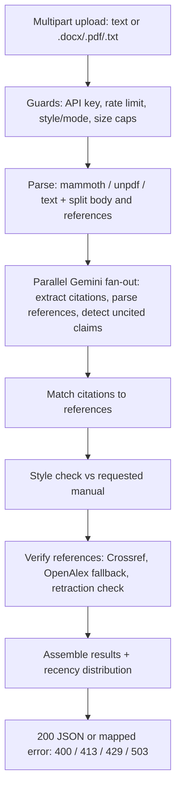
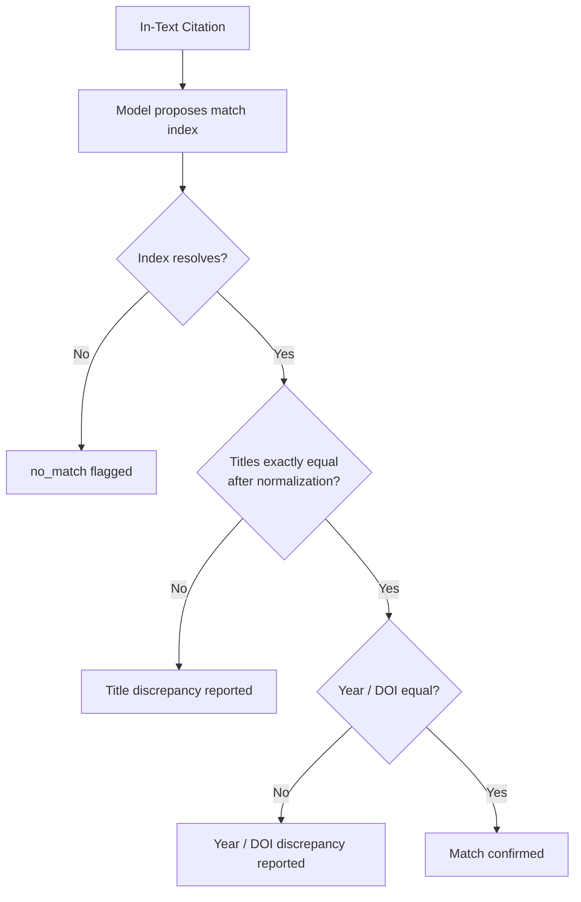

# AI/NLP Pipeline Design Document

This document describes the shipped Artificial Intelligence (AI) and Natural Language Processing (NLP) pipeline for CitePilot. The whole workload runs inside the Next.js app (`citepilot-web/src/lib/ai/`, exposed as Route Handlers): Google Gemini 2.5 Flash Lite (with same-provider fallbacks) performs extraction, matching, and explanations, while Crossref/OpenAlex verification, counting, comparison, and scoring stay in code. There are no deterministic rule engines and no hallucination detector — anything the pipeline cannot verify is reported as unverified, never guessed.

---

## 1. Pipeline Overview

The CitePilot processing pipeline is **synchronous and single-pass**: one `POST /api/v1/analyse` request triggers the full pipeline below and returns the complete analysis in a single response. Documents range from short essays to multi-chapter dissertations; there is no queue in the MVP (ADR-011). A streaming websocket variant is roadmap-only (see `12-api-specification.md` §3.5); it is not shipped.

Guard and error behavior lives in `src/app/api/v1/analyse/route.ts`; orchestration in `src/lib/ai/pipeline.ts`. The first exception in the fan-out aborts the run; provider outages surface as `503` without leaking internals.

---

## 2. Reference Section Detection & Extraction

CitePilot splits body from bibliography with a TOC-safe heading match (`splitBodyAndReferences` in `src/lib/ai/document-parser.ts`): the last `References|Bibliography|Works Cited|Reference List` heading past the first 15% of long documents wins, so Tables of Contents near the top are never mistaken for the split point. `reference_only` mode skips the body entirely.

### 2.1 Detection Strategy
1. **Structural parse**: `.docx` via `mammoth` (heading styles preserved), `.pdf` via `unpdf` (per-page line regrouping), anything else as UTF-8 text — each producing paragraph metadata (`paragraph_index`, `style_name`, `is_heading`, `char_count`).
2. **Heading match**: regex over `References|Bibliography|Works Cited|Reference List` (case-insensitive), scanning matches last-to-first.
3. **No LLM classifier and no chapter-scoped multi-list linking**: multi-list documents are processed as one reference stream.

---

## 3. In-Text Citation Extraction

CitePilot extracts across the styles in `ALLOWED_CITATION_STYLES` (`src/lib/ai/config.ts`): APA 7th/6th, Harvard, Vancouver, Chicago (author-date + notes), MLA 9, IEEE, OSCOLA, Turabian.

### 3.1 Extraction Pipeline
1. **Paragraph chunking**: ≤30 paragraphs go in a single call; larger manuscripts are chunked (25 paragraphs + 2 overlap) and deduplicated by `(paragraph_index, normalized raw_text)`.
2. **Context-preserving LLM extraction**: each citation is returned with exact raw text, paragraph index, character offsets, ±100-char context, type, author surnames, and year — which is what lets the UI highlight findings in place. Generic year mentions and headings are excluded by prompt, not by a regex pre-filter.

---

## 4. Reference Parsing & Segmentation

Individual reference entries are parsed into structured metadata (authors, title, journal, volume, issue, pages, DOI, year).

### 4.1 Parser Specification
- **Input**: raw reference-list text.
- **Processing**: ≤30k chars in one Gemini call with a JSON example; larger lists split into ~20k-char chunks, deduplicated by normalized entry, positions renumbered.
- **Validation**: every model response is validated with zod (`ReferencesResponseSchema`). A malformed response throws `AIServiceError` and fails the run loudly — it is never coerced into an empty result.

---

## 5. Matching & Consistency Algorithm

Citations are matched to references in a **single Gemini matching pass** that returns a 0-based `matched_reference_index`, a `match_type` (`exact`/`fuzzy`/`ai_verified`/`none`), confidence, and spelling/year issues per citation.

There is no Levenshtein/threshold layer: after the model proposes a match, field-level discrepancy detection in code uses exact normalized title equality (`titlesMatch` — case, punctuation, and stop-word normalized, no similarity score). A near-miss is reported as a discrepancy, never auto-accepted as a fuzzy match.

### 5.1 Verification Flowchart

---

## 6. External Validation & Retraction Detection

One of CitePilot's core differentiators is verifying whether cited papers actually exist, using explicit publisher metadata — never guesses.

### 6.1 Validation Pipeline
1. **Metadata lookup**: Crossref by DOI, else title + author search (`src/lib/ai/crossref.ts`).
2. **OpenAlex fallback**: when Crossref does not verify a reference that has a DOI or title, OpenAlex is queried and a successful hit is merged in as `provider: "openalex"` with canonical title/DOI/year (`src/lib/ai/openalex.ts`).
3. **404 vs outage**: a Crossref/OpenAlex 404 is a genuine "not found"; timeouts and 5xx are outages. Timeouts (10 s) and failures never masquerade as misses — failed provider checks are recorded as `verification_unavailable` (`src/lib/ai/pipeline.ts`).
4. **Retraction checking**: only explicit Crossref signals count — `is-retracted-by` relations, `update-to` retraction/withdrawn labels, and Expressions of Concern. Title-text prefix guessing was removed: without retraction metadata the status is `normal` (`src/lib/ai/retraction.ts`).
5. **No hallucination detector**: the pipeline does not flag fabricated references. Unverifiable references are reported as unverified with their discrepancies, and the UI must not present them as confirmed fakes.

---

## 7. Style Checking & Explanations

Style checking is a single Gemini pass against the requested manual (`src/lib/ai/citation-extractor.ts` `checkStyle`): missing commas, `p.`/`pp.` indicators, `&` vs `and`, `et al.` usage, missing DOIs, title capitalization, and page ranges — each with the exact `target_text` where the violation occurs. There is no separate rule engine; the prompt carries the checklist and zod enforces the output shape.

---

## 8. Uncited Claims, Recency & Exports

- **Uncited claims** (`src/lib/ai/uncited-claims.ts`): one Gemini pass over up to ~115k chars of body paragraphs. Own-study/methodology statements, headings, captions, anecdotes, and overviews are excluded by prompt. Detector failure returns `[]` (fail-soft) rather than failing the audit.
- **Recency** (`src/lib/ai/recency.ts`): pure function over parsed reference years — 3/5/10-year distributions, average age. It reports counts and percentages only; there are no compliance tiers or grades.
- **Exports** (`src/lib/ai/export.ts`, `POST /api/v1/export/{pdf,docx}`): clean/redline DOCX via `docx`, diagnostic PDF via `pdf-lib`. Redline highlights paragraphs containing flagged `target_text` and appends the warning text.

---

## 9. Performance Benchmarks

To ensure an excellent user experience, the AI/NLP pipeline is optimized for latency and accuracy:

- **Accuracy Target**: F1 Score $\ge 0.95$ for citation extraction.
- **Latency Targets** (matching the support documentation):
  - Short documents (< 5,000 words): 5–15 seconds.
  - Medium documents (5,000–20,000 words): 15–45 seconds.
  - Thesis-length (50,000+ words): 2–3 minutes.
- **Provider Policy**: Google Gemini 2.5 Flash Lite is the default model (`GEMINI_MODEL`), with same-provider fallbacks (`FALLBACK_MODELS` in `src/lib/ai/config.ts`) retried with backoff on 429/503-class errors. If every candidate fails, the audit fails openly with a retry prompt (`503`) — there is no silent fallback provider and no invented empty result in the MVP (see `06-operations/25-runbooks.md`).
